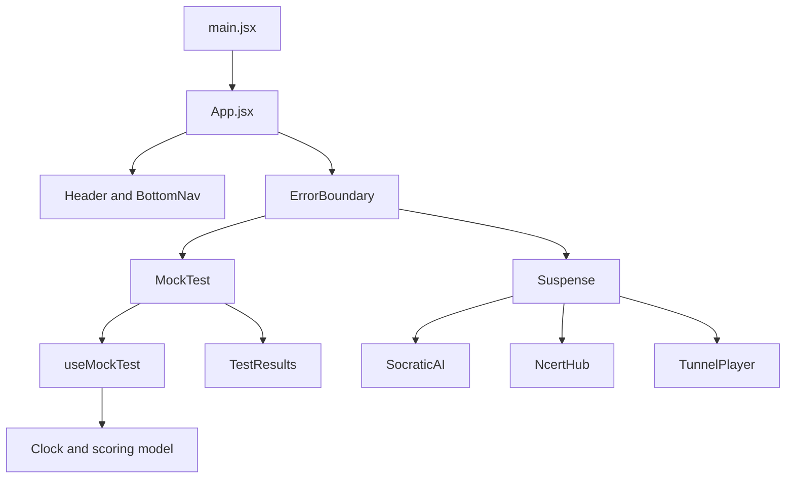

# Gnosis architecture and hierarchy

## Architecture decision

Use a feature-based client-side SPA. The root composes the application shell; feature folders own screens, content and business logic. Reusable components own navigation and general failure presentation. Styling has one semantic token layer, with a scoped chat theme. No global state framework, router library, animation library, charting runtime or backend is necessary for this four-tab prototype.

## Runtime hierarchy



`main.jsx` mounts React in StrictMode and imports shared styles and the initial font. `App.jsx` owns the current tab and renders one active feature. Mock Test stays mounted but hidden on other tabs to preserve answers without serializing state. Its clock is disabled when hidden. The other three feature modules are dynamically imported, and their UI unmounts when exited. The AI hint status lives in App so a revealed hint survives tab changes. An in-progress hint timeout is cancelled on exit and restarted on return.

## Responsibility map

| File / folder | Responsibility | Change it when |
| --- | --- | --- |
| `src/main.jsx` | React entry, StrictMode and shared CSS | Changing app mounting |
| `src/App.jsx` | Navigation state, screen headings, lazy boundaries, Lite mode | Adding a feature or shell state |
| `src/components/Header.jsx` | Brand and Lite-mode switch | Editing global header |
| `src/components/BottomNav.jsx` | Four accessible navigation buttons | Adding or renaming tabs |
| `src/components/ErrorBoundary.jsx` | Recoverable render/chunk failure UI | Adding error reporting |
| `src/components/styles.js` | Shared button class contracts | Changing common button variants |
| `src/features/mock-test/MockTest.jsx` | Test form, navigation, response selection | Editing question UI |
| `src/features/mock-test/TestResults.jsx` | Score summary and question-level analysis | Extending results |
| `src/features/mock-test/useMockTest.js` | Answers, question index, submission and timer lifecycle | Changing test behaviour |
| `src/features/mock-test/model.js` | Pure clock, scoring, formatting and trap rules | Changing marking or timing rules |
| `src/features/mock-test/questions.js` | Questions, options, correct indices, explanations | Replacing question content |
| `src/features/socratic/SocraticAI.jsx` | Problem, hint action, simulated delay | Adding real conversational UX |
| `src/features/socratic/hints.js` | Fixed conceptual hint | Editing guidance |
| `src/features/socratic/fonts.css` | Lazy AI-only font declarations | Changing AI typography |
| `src/features/ncert/NcertHub.jsx` | Chapter shelf and expandable summaries | Adding resource reading UX |
| `src/features/ncert/chapters.js` | Chapter titles and topic metadata | Updating curriculum list |
| `src/features/player/TunnelPlayer.jsx` | Click-to-load video and fallback link | Changing playback UX |
| `src/features/player/video.js` | Video ID/title | Selecting a real lesson |
| `src/styles/tokens.css` | Ocean/chat colours and font families | Changing design-system values |
| `src/styles/index.css` | Global resets, layout and reusable component rules | Changing responsiveness |
| `src/styles/fonts.css` | Initial self-hosted variable font | Changing base typography |
| `tests/model.test.js` | Deterministic clock and scoring checks | Changing domain rules |
| `vite.config.js` | React/Tailwind compilation, relative asset base | Changing build/deployment |
| `package.json`, `package-lock.json` | Scripts and reproducible dependencies | Updating toolchain |

## Data flow and state ownership

1. BottomNav sends a tab ID to App. The shell changes the heading and theme.
2. MockTest calls its local hook. Selecting an option updates one answer entry. Unanswered is `null`, distinct from option index `0`.
3. The clock uses `performance.now()` and accumulates milliseconds into a mutable ref. A one-second interval publishes a snapshot to local React state. The interval is not the source of truth.
4. Before question changes, submission, tab exit or page hiding, elapsed time is committed. Returning to a question resumes its existing total.
5. Submission stops timing. Pure `analyse()` computes score and counts. `isTimeTrap()` uses `ms > 30000`, not rounded display seconds.
6. SocraticAI updates its small hint status through App. No network request or secret is involved.
7. NcertHub owns one expanded-row index. TunnelPlayer owns one boolean and makes no YouTube request until Load lesson is clicked.

## State lifetime

| State | Owner | Survives tab switch? | Survives reload? |
| --- | --- | --- | --- |
| Current tab / Lite mode | App | Yes | No |
| Answers, timers, submitted results | useMockTest | Yes | No |
| Hint status | App | Yes; pending delay restarts | No |
| Expanded chapter | NcertHub | No | No |
| Video/iframe | TunnelPlayer | No; unloads to stop work | No |

## Low-device strategy

- Default Lite mode disables blur, shadows, animations and transitions; it does not remove content or focus outlines.
- Secondary screens are code-split. Their code is downloaded only when requested; browser caching avoids repeated transfers.
- Timers rerender the test feature once per second, not the shell. No animation-frame loop. Hidden test/hidden document time is excluded.
- No stock photos, video posters or full icon fonts. Only named Lucide exports are bundled.
- Tailwind is compiled at build time, with no browser CDN compiler.
- Fonts use local WOFF2, variable weights and swap rendering. Chat fonts are deferred with chat CSS.
- YouTube is the largest external runtime; mounting it requires a user action, and leaving the tab removes it.
- Do not claim universal hardware support: this targets modern browsers on modest devices. Actual responsiveness depends on OS, browser, memory and network.

## Extension plan

Keep future additions behind feature boundaries:

- Real AI: introduce a server endpoint and a client service in `features/socratic/`; keep API keys on the server, add cancellation and error states.
- Offline resources: implement a versioned service worker/cache strategy and IndexedDB download metadata; show Available Offline only after cache verification. Add storage failure and eviction handling.
- Persistence: write answer/timer snapshots on meaningful events rather than every tick; validate versions when restoring. IndexedDB is appropriate for PDFs, local storage only for small preferences.
- Routing: introduce route URLs when deep linking/back-button navigation becomes a requirement; do not add a router merely for four internal tabs.
- Tests at scale: add browser interaction tests and real-device performance budgets before production release.

## File tree

See the generated tree below. `node_modules/` and `dist/` are intentionally excluded from the source package.

```text
.gitignore
README.md
docs/ARCHITECTURE.md
docs/DESIGN-SYSTEM.md
docs/VALIDATION.md
docs/font-licenses/inter.txt
docs/font-licenses/jetbrains-mono.txt
docs/font-licenses/plus-jakarta-sans.txt
index.html
package-lock.json
package.json
src/App.jsx
src/components/BottomNav.jsx
src/components/ErrorBoundary.jsx
src/components/Header.jsx
src/components/styles.js
src/features/mock-test/MockTest.jsx
src/features/mock-test/TestResults.jsx
src/features/mock-test/model.js
src/features/mock-test/questions.js
src/features/mock-test/useMockTest.js
src/features/ncert/NcertHub.jsx
src/features/ncert/chapters.js
src/features/player/TunnelPlayer.jsx
src/features/player/video.js
src/features/socratic/SocraticAI.jsx
src/features/socratic/fonts.css
src/features/socratic/hints.js
src/main.jsx
src/styles/fonts.css
src/styles/index.css
src/styles/tokens.css
tests/model.test.js
vite.config.js
```
